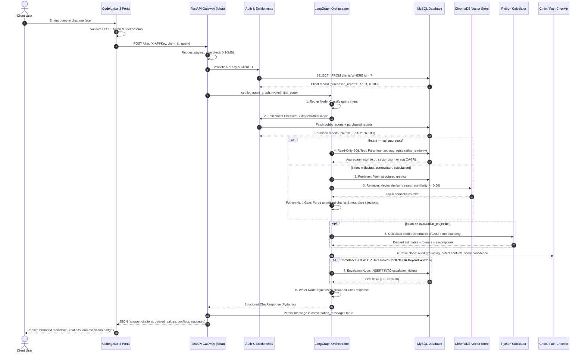
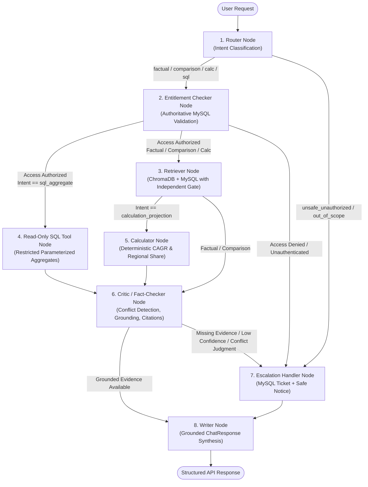

# Project Atlas — System Architecture & Component Interactions

## 1. Architectural Overview

**Project Atlas** is an enterprise-grade AI Market Research Report Copilot designed to provide grounded, citation-backed answers to complex market intelligence questions while enforcing client purchase permissions.

The system combines:
1. **Relational MySQL Database (`project_atlas`)**: Stores structured report metadata, granular market metrics (market size, CAGR, forecasts), client profiles, conversation records, and analyst escalation tickets.
2. **Local Persistent ChromaDB (`chroma_data/`)**: Provides local vector embeddings of report narratives without third-party cloud vector dependencies.
3. **LangGraph Agent Workflow**: An 8-node stateful directed acyclic graph (DAG) coordinating intent classification, permission validation, multi-source retrieval (SQL + Vector), deterministic arithmetic, critique, escalation, and evidence synthesis.
4. **FastAPI Backend (Python 3.11+)**: Exposes asynchronous RESTful endpoints with Pydantic v2 validation, API key authentication, request timeout middleware, and structured logging.
5. **CodeIgniter 3 Portal (PHP 7.4 / 8.x)**: Provides a legacy enterprise web portal for client account management, live chat with message streaming, and thumbs up/down feedback.
6. **Docker Compose**: Containerizes the application stack into isolated microservices with reproducible startup and healthchecks.

---

## 2. End-to-End Chat Request Lifecycle



---

## 3. How LangGraph Routes Questions

The orchestration engine uses **LangGraph** (`langgraph.graph.StateGraph`) to govern conversational execution through an 8-node state graph:



### The 6 Intent Classifications
1. `factual_lookup`: Single-topic inquiries resolved by retrieving authorized metrics or text chunks.
2. `comparison`: Inquiries spanning multiple reports requiring side-by-side reconciliation without illegal averaging.
3. `calculation_projection`: Inquiries requiring mathematical compounding ($FV = BV \times (1 + CAGR)^n$) or regional market sizing.
4. `sql_aggregate`: Relational queries (e.g., sector distributions, average CAGR across reports, maximum recorded market size).
5. `out_of_scope`: Non-research inquiries (politics, elections, personal private data, culinary recipes) routed to safe refusal and escalation.
6. `unsafe_unauthorized`: Adversarial prompt injections or database mutation commands (`DROP`, `DELETE`, password dumps) routed to immediate security containment.

---

## 4. How MySQL Entitlements Control Access

Entitlements determine which reports a client is permitted to view. The system enforces client permissions at three distinct layers:

### 1. Authoritative Permission Discovery
In [`ClientService.get_permitted_reports(db, client_id)`](file:///backend/app/services/client_service.py), the system queries MySQL to construct the client's entitled report set:
$$\text{Permitted Reports} = \text{Purchased Reports} \cup \text{Public Reports}$$
- **Client C-01**: Purchased `R-101, R-103`. Plus public `R-102` $\rightarrow$ Permitted: `['R-101', 'R-102', 'R-103']`.
- **Client C-02**: Purchased `R-103`. Plus public `R-102` $\rightarrow$ Permitted: `['R-102', 'R-103']`. Protected `R-101` is strictly excluded.

### 2. Pre-Retrieval Filtering
- ChromaDB vector queries apply a metadata filter: `{"report_id": {"$in": list(permitted_reports)}}`.
- Relational metric queries filter: `MarketMetric.report_id.in_(permitted_reports)`.

### 3. Hard Python Gating (Defense in Depth)
Even after vector filtering, [`retriever_node`](file:///backend/app/agents/nodes.py#L246-L255) independently verifies each retrieved chunk against MySQL:
```python
verified_chunks = []
for chunk in candidate_chunks:
    rep_id = chunk["metadata"]["report_id"]
    has_access, _ = ClientService.check_report_access(db, client_id, rep_id)
    if has_access:
        verified_chunks.append(chunk)
    else:
        logger.error(f"ACCESS_DENIED_CHUNK: Blocked unentitled chunk from '{rep_id}' for client '{client_id}'")
```
Unauthorized chunks are purged before entering the LLM context, guaranteeing zero intellectual property leaks.

---

## 5. How ChromaDB Retrieves Report Chunks

Project Atlas uses **ChromaDB** configured strictly in **local persistent storage mode** (`chroma_data/`), avoiding cloud vector database vendor lock-in:

1. **Embedding Model**: Text chunks are embedded using `sentence-transformers/all-MiniLM-L6-v2` via Hugging Face / local ONNX runtime (384-dimensional dense vectors).
2. **Chunking Strategy**: Documents are parsed and chunked using recursive character splitting (target chunk size: 800 characters, overlap: 150 characters) preserving section headers, table metadata, and page numbers.
3. **Similarity Search**: Queries are executed via `vector_store_service.entitled_similarity_search()`:
   - Queries are embedded and compared using cosine distance.
   - Distance scores are converted to similarity scores: $\text{similarity} = 1.0 - \text{distance}$.
   - Chunks falling below `settings.RAG_SIMILARITY_THRESHOLD` ($0.60$) are discarded to prevent hallucinated low-relevance grounding.
4. **Prompt Injection Sanitization**: Chunks containing adversarial instruction indicators (such as the evaluation trap in `R-102.html`) have their command instructions neutralized while preserving legitimate numerical metrics ($3.87\text{B}$, $9.8\%$ CAGR).

---

## 6. How Citations and Source Conflicts are Validated

To prevent hallucinated citations and ungrounded claims, the system applies strict post-retrieval validation via [`CitationValidator`](file:///backend/app/tools/citation_validator.py):

### Citation Requirements
- Every claim must map to an authentic report in the authorized catalog registry (`REPORT_CATALOG_REGISTRY`).
- The validator enforces authentic document titles, page numbers, and supporting excerpts. Fabricated citations (e.g. non-existent page numbers) are stripped.
- Citations from unentitled reports are purged.

### Source Conflict Detection & Scope Disambiguation
The seed catalog presents a core conflict in the 2024 global smart water meter market:
- **Report R-101 (CMR)**: **USD 4.21 Billion** (Full System: hardware, telemetry, MDMS software, and utility cloud services).
- **Report R-102 (Aquila Insights)**: **USD 3.87 Billion** (Physical AMR/AMI hardware endpoints only).

[`ConflictDetector.detect_conflicts()`](file:///backend/app/tools/citation_validator.py) evaluates retrieved metrics across permitted reports:
1. **Separate Presentation**: Both values are displayed independently with their respective scopes.
2. **Scope Disambiguation**: Explains why the figures differ (system-wide vs hardware-only).
3. **Strict No-Averaging Rule**: The system refuses to average the figures ($\frac{4.21 + 3.87}{2} = 4.04$ is strictly prohibited).
4. **Judgment Trigger**: If the user asks which figure is "definitive", "correct", or "to trust", the system refuses to make an arbitrary judgment and escalates to a human analyst.

---

## 7. How the Calculator Produces Derived Values

Arithmetic is never delegated to the LLM. All calculations are executed deterministically in pure Python via [`MarketCalculator`](file:///backend/app/tools/calculator.py):

### CAGR Future Valuation Formula
$$\text{Future Value} = \text{Base Value} \times (1 + \text{CAGR})^n$$
Where:
- $\text{Base Value}$: Starting market valuation in base year ($BV > 0$).
- $\text{CAGR}$: Annual compound growth rate expressed as a decimal ($11.2\% \rightarrow 0.112$).
- $n$: Number of compounding periods ($\text{Target Year} - \text{Base Year}$).

### Regional Share Sizing Formula
$$\text{Regional Size} = \text{Global Size} \times \left(\frac{\text{Share \%}}{100}\right)$$

### Forecast Window Boundaries & Refusal of Silent Extrapolation
Each report catalog definition includes verified forecast boundaries:
- `R-101`: Base year $2024$, Max forecast year $2030$.
- `R-102`: Base year $2024$, Max forecast year $2029$.

If a query requests a projection beyond the verified forecast window (e.g., asking for 2035 when the window ends in 2030):
1. The calculator flags `extrapolation_beyond_window = True`.
2. Silent extrapolation is refused.
3. The response clearly explains that extending projections beyond published research windows without econometric modeling is prohibited.
4. The inquiry is flagged with `requires_escalation = True` and an analyst escalation ticket is created.

---

## 8. How Escalations are Stored

Escalations are managed by [`EscalationService`](file:///backend/app/services/escalation_service.py) and persisted in the MySQL `escalation_tickets` table:

### Escalation Triggers
1. Confidence score falls below threshold ($\text{confidence} < 0.70$).
2. Material numerical claims cannot be grounded in authorized reports.
3. Material conflicts require human judgment (e.g. user asks which conflicting report to trust).
4. Calculation requests extend beyond verified forecast windows (extrapolation refusal).
5. User explicitly requests a human analyst ("talk to an analyst", "open a ticket").
6. Adversarial prompt injection or unauthorized access attempts.

### Ticket Persistence Schema
```sql
CREATE TABLE `escalation_tickets` (
    `id` INT AUTO_INCREMENT PRIMARY KEY,
    `ticket_id` VARCHAR(20) NOT NULL UNIQUE,     -- e.g., 'ESC-0218'
    `client_id` VARCHAR(10) NOT NULL,
    `query_text` TEXT NOT NULL,
    `reason` VARCHAR(255) NOT NULL,
    `status` ENUM('open', 'in_progress', 'resolved', 'closed') DEFAULT 'open',
    `priority` ENUM('low', 'medium', 'high', 'critical') DEFAULT 'medium',
    `metadata_json` JSON,                       -- Non-sensitive audit metadata
    `created_at` DATETIME DEFAULT CURRENT_TIMESTAMP,
    `resolved_at` DATETIME NULL,
    INDEX `idx_client_status` (`client_id`, `status`)
);
```

### Duplicate Suppression
If an identical unresolved escalation ticket exists for the same client and query within a 1-hour window, `EscalationService` reuses the existing ticket ID rather than cluttering MySQL with redundant records.

---

## 9. How the CodeIgniter 3 Portal Communicates with FastAPI

The legacy PHP portal integrates with FastAPI using a dedicated service client library ([`Fastapi_client.php`](file:///php-portal/application/libraries/Fastapi_client.php)):

```mermaid
flowchart LR
    User["Browser"] -->|HTTP POST| CI3Controller["Chat Controller\n(controllers/Chat.php)"]
    CI3Controller -->|Session Auth & CSRF| FastApiClient["FastAPI Client Library\n(libraries/Fastapi_client.php)"]
    FastApiClient -->|cURL HTTP Request\nHeader: X-API-Key\nTimeout: 30s| FastAPIServer["FastAPI Server\n(/chat)"]
    FastAPIServer -->|JSON Response| FastApiClient
    FastApiClient -->|Parsed DTO| CI3Controller
    CI3Controller -->|html_escape()| ChatView["Chat View\n(views/chat_view.php)"]
```

### Key Integration Mechanics
1. **cURL Service Wrapper**: `Fastapi_client.php` encapsulates HTTP communication using PHP cURL, passing `X-API-Key`, request timeouts ($30\text{ seconds}$), and connecting to `http://backend:8000` (Docker) or `http://127.0.0.1:8000` (Local).
2. **Session-Bound Identity**: The client ID (`C-01` or `C-02`) is strictly loaded from the authenticated PHP session (`$this->session->userdata('client_id')`) and cannot be spoofed from form inputs.
3. **Cross-Site Scripting (XSS) Prevention**: All dynamic values rendered in `chat_view.php` are escaped using CodeIgniter's `html_escape()`.
4. **Cross-Site Request Forgery (CSRF) Prevention**: Forms include `$this->security->get_csrf_token_name()` and token hashes.
5. **Graceful Fallbacks**: If the FastAPI backend is down or times out, the portal returns a user-friendly error notice: *"The AI Market Research Copilot is temporarily unavailable. Please try again shortly."* without exposing PHP stack traces.
