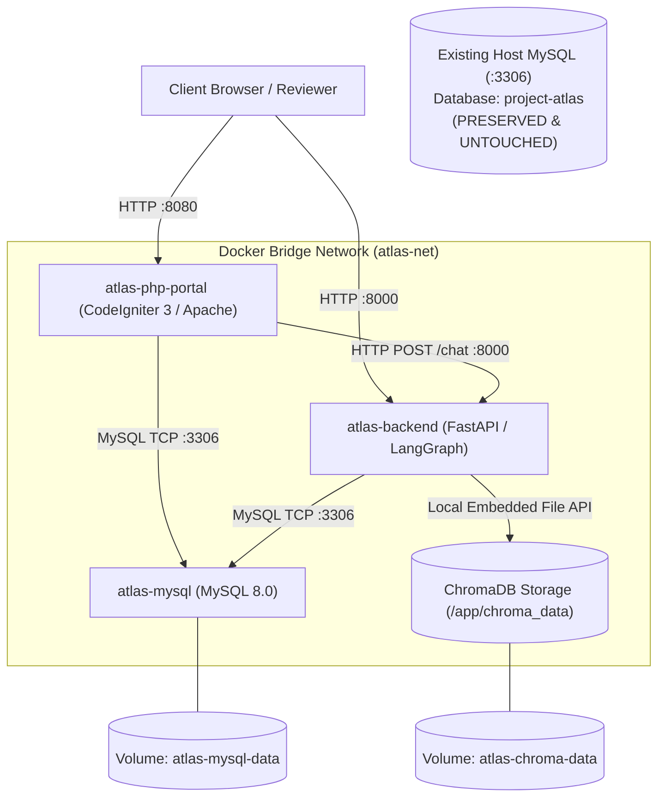

# Project Atlas &mdash; Deployment & Operations Guide

This guide documents the local Linux-compatible containerized deployment process for Project Atlas using Docker Compose, while guaranteeing absolute safety and non-interference for existing host development databases.

---

## 1. Architecture & Service Topology

Project Atlas consists of three containerized services communicating over an isolated Docker bridge network (`atlas-net`):



| Service | Internal Port | Host Port | Persistent Storage | Purpose |
| :--- | :--- | :--- | :--- | :--- |
| **`atlas-mysql`** | `3306` | `3307` (configurable) | Named Volume `atlas-mysql-data` | Authoritative relational database (clients, reports, metrics, conversations, feedback, escalations). |
| **`atlas-backend`** | `8000` | `8000` | Named Volume `atlas-chroma-data` | FastAPI API server, LangGraph agent, deterministic calculator, and embedded ChromaDB vector store. |
| **`atlas-php-portal`**| `80` | `8080` | None (stateless app) | CodeIgniter 3 legacy portal with CSRF protection, session authorization, and interactive research chat. |

---

## 2. Critical Database Safety & Non-Interference Guarantee

> [!IMPORTANT]
> **Existing Host Database Safety**: If you have an existing development database named `project-atlas` running on host port `3306`, Docker Compose **will not overwrite, alter, or connect to it**.

### How Non-Interference is Enforced:
1. **Host Port Separation**: The Docker MySQL container binds to host port **`3307`** (`${MYSQL_HOST_PORT:-3307}:3306`). Host port `3306` is completely untouched.
2. **Dedicated Named Volume**: Docker Compose uses an isolated named volume (`atlas-mysql-data`). No container mounts or accesses host database data directories.
3. **One-Time Container Initialization**: The script [`docker/mysql/init/01-init-schema-and-seed.sql`](file:///c:/Users/NEW%20BAG%20COLLECTION/OneDrive/Desktop/Assets/Project-Atlass/docker/mysql/init/01-init-schema-and-seed.sql) is mounted exclusively into `/docker-entrypoint-initdb.d:ro` inside the container. It runs **only** when initializing a fresh Docker volume and never touches host MySQL instances.

### Developing Against Your Existing Host Database
If you wish to develop locally against your existing host MySQL instance (named `project-atlas` or `project_atlas` on port 3306) without Docker:
1. Set the following in your host `.env`:
   ```bash
   DB_HOST=127.0.0.1
   DB_PORT=3306
   DB_NAME=project-atlas
   DB_USER=root
   DB_PASSWORD=your_host_mysql_password
   ```
2. Run your local virtual environment:
   ```bash
   .venv\Scripts\python.exe -m uvicorn app.main:app --host 127.0.0.1 --port 8000
   ```
   The local application connects directly to your existing host database without triggering any Docker scripts or volume mounts.

---

## 3. Step-by-Step Reviewer Startup Process

### Step 1: Clone and Configure Environment
Copy the configuration template:
```bash
cp .env.example .env
```
*(The default values in `.env.example` are pre-configured for instant Docker Compose execution).*

### Step 2: Build and Launch Containers
Launch all services in detached mode:
```bash
docker compose up -d --build
```

### Step 3: Verify Health Status
Docker Compose includes health checks for all three services:
```bash
docker compose ps
```
Expected output:
```text
NAME                IMAGE               COMMAND                  SERVICE             STATUS                    PORTS
atlas-mysql         mysql:8.0           "docker-entrypoint.s…"   mysql               Up (healthy)              0.0.0.0:3307->3306/tcp
atlas-backend       project-backend     "/entrypoint.sh"         backend             Up (healthy)              0.0.0.0:8000->8000/tcp
atlas-php-portal    project-php         "apache2-foreground"     php-portal          Up (healthy)              0.0.0.0:8080->80/tcp
```

### Step 4: Access Review Endpoints
Once healthy, access the system interfaces:
- **CodeIgniter 3 Portal**: [http://localhost:8080](http://localhost:8080)
- **FastAPI OpenAPI Docs**: [http://localhost:8000/docs](http://localhost:8000/docs)
- **FastAPI Health Endpoint**: [http://localhost:8000/health](http://localhost:8000/health)

---

## 4. Idempotent Ingestion & Startup Behavior

To prevent duplicate chunks and unnecessary embedding re-calculations on container restarts, Project Atlas implements two layers of ingestion protection:

1. **Startup Check (`startup_ingest.py`)**:
   During container boot, [`docker/backend-entrypoint.sh`](file:///c:/Users/NEW%20BAG%20COLLECTION/OneDrive/Desktop/Assets/Project-Atlass/docker/backend-entrypoint.sh) executes [`backend/scripts/startup_ingest.py`](file:///c:/Users/NEW%20BAG%20COLLECTION/OneDrive/Desktop/Assets/Project-Atlass/backend/scripts/startup_ingest.py).
   - If `collection.count() > 0`, it logs:
     `[StartupIngest] ChromaDB collection 'market_reports' already contains X chunks. Skipping repeated ingestion.`
   - If `collection.count() == 0`, it performs an initial indexing of the sample reports (`R-101.md`, `R-102.html`, `R-103.md`).
2. **Stable Chunk Hash IDs**:
   All chunk IDs are deterministic hashes computed from the report ID, page number, and content:
   `f"{report_id}_p{page}_c{chunk_index}_{sha256[:8]}"`
   Even if an ingestion command is manually triggered via `POST /ingest`, ChromaDB executes an `upsert` operation, replacing existing records with identical IDs instead of duplicating them.

---

## 5. Teardown & Reset Commands

### Standard Stop (Preserves All Data)
To stop the services while preserving MySQL records and ChromaDB embeddings:
```bash
docker compose down
```

### Clean Reset for a Fresh Review Environment
To completely purge container volumes and test a fresh initial deployment from scratch:
```bash
docker compose down -v
docker compose up -d --build
```
*(This command purges only the named Docker volumes `atlas-mysql-data` and `atlas-chroma-data`. It **never** touches your host database).*

---

## 6. Container Logs & Debugging

View aggregated logs:
```bash
docker compose logs -f
```

View specific service logs:
```bash
# FastAPI Backend
docker compose logs -f backend

# MySQL Server
docker compose logs -f mysql

# PHP Portal
docker compose logs -f php-portal
```
