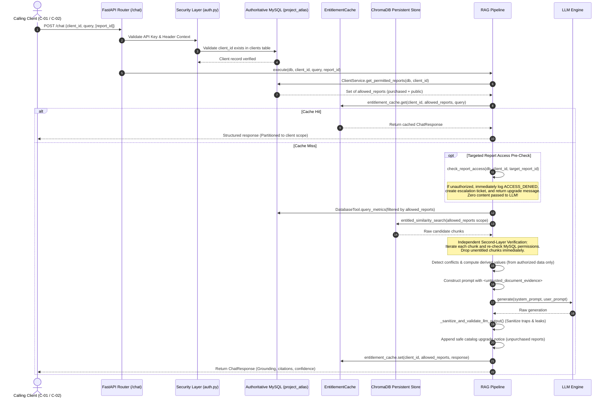

# Project Atlas &mdash; Entitlement-Aware Authorization & Retrieval Flow

**Authoritative Source**: Existing MySQL Database (`project_atlas`)  
**Security Model**: Defense-in-Depth (Multi-Layer Hard Verification)  
**Vector Store**: ChromaDB (Restricted Scope + Independent Python Validation)  
**Caching Engine**: Entitlement-Partitioned TTL Cache  

---

## 1. Authoritative MySQL Seed State

Direct inspection of the existing relational database confirms the following authoritative records:

### Clients Table (`clients`)
| Client ID | Company Name | Purchased Reports | Public Access | Total Entitled Scope |
| :--- | :--- | :--- | :--- | :--- |
| **`C-01`** | Northwind Utilities | `R-101, R-103` | `R-102` | `['R-101', 'R-102', 'R-103']` |
| **`C-02`** | Blue Delta Infra | `R-103` | `R-102` | `['R-102', 'R-103']` |

### Reports Table (`reports`)
| Report ID | Title | Access Level | Description |
| :--- | :--- | :--- | :--- |
| **`R-101`** | Global Smart Water Meter Market 2025 | `paid` | Full system hardware + analytics (CAGR 11.2%, USD 4.21 B) |
| **`R-102`** | Smart Water Metering: Industry Outlook 2024 | `public` | Physical hardware scope (CAGR 9.8%, USD 3.87 B) |
| **`R-103`** | Residential Water Purifier Market | `paid` | Consumer durables / point-of-use purification |

> [!IMPORTANT]
> **Zero Database Mutations**: All existing seed purchases and records in MySQL were strictly preserved without modification, truncation, or overwrites.

---

## 2. End-to-End Entitlement-Aware Flow



---

## 3. Defense-in-Depth Security Principles

### Principle 1: MySQL is the Sole Authoritative Source
* ChromaDB metadata filtering is **never** the sole security boundary.
* Prior to vector retrieval, the client's purchased report IDs and public reports are dynamically fetched from MySQL.
* Every retrieved candidate chunk is verified a second time against `ClientService.check_report_access()` in Python before being assembled into the prompt context.

### Principle 2: Zero Leakage Across Surfaces
Unauthorized content cannot leak across any application surface:
1. **LLM Context**: Purged of all unentitled report text before prompt generation.
2. **Citations**: `CitationItem` entries are only generated for authorized metrics and chunks.
3. **Derived Values**: Formulas exclusively use metrics from authorized reports.
4. **Logs**: Access-denial events record client and report identifiers, never protected report text:
   `ACCESS_DENIED: client='C-02' attempted access to unpurchased report='R-101'`
5. **Cached Responses**: Keyed by `SHA-256(client_id | sorted_allowed_scope | target_report | query)`.
6. **Error Messages**: State access denial without quoting proprietary findings or numbers.

### Principle 3: Safe Catalog Mention & Upgrade Routing
When a client requests or is relevant to an unpurchased report:
- The application safely acknowledges the report's existence in the Project Atlas library using public catalog metadata (`id`, `title`, `access`).
- It does **not** reveal proprietary metrics (e.g. 11.2% CAGR or $4.21B market size).
- It generates an analyst escalation ticket and provides an access-upgrade message.

---

## 4. Test Verification Results

All 9 dedicated entitlement-aware retrieval tests passed in [`backend/tests/test_entitlement_retrieval.py`](file:///c:/Users/NEW%20BAG%20COLLECTION/OneDrive/Desktop/Assets/Project-Atlass/backend/tests/test_entitlement_retrieval.py):

| Test Case | Scenario / Condition Tested | Expected Result | Status |
| :--- | :--- | :--- | :---: |
| `test_c01_can_access_r101_and_r103` | C-01 requests R-101 and R-103 | Access granted, 11.2% / $4.21B returned, cited | **PASSED** |
| `test_c01_cannot_access_unpurchased_reports` | C-01 requests unpurchased report R-104 | Access denied, confidence=0.0, zero citations, ticket logged | **PASSED** |
| `test_c02_cannot_obtain_r101_figures` | C-02 queries private report R-101 | Access denied, 11.2% / $4.21B never leaked, upgrade offered | **PASSED** |
| `test_c02_can_access_r103` | C-02 requests purchased report R-103 | Access granted, R-103 citations present | **PASSED** |
| `test_unknown_client_rejected` | Unknown client `C-UNKNOWN` queries API | HTTP 404 at API layer, escalated=True at pipeline layer | **PASSED** |
| `test_manipulating_client_id_does_not_bypass_authorization` | Tampering `client_id` (e.g. C-ADMIN or C-02 requesting R-101) | Blocked by MySQL authorization, cannot access unpurchased data | **PASSED** |
| `test_unauthorized_content_never_reaches_llm` | Prompt inspection during C-02 query | R-101 chunks and metrics stripped before LLM `generate()` | **PASSED** |
| `test_entitlement_aware_cache_partitioning` | Identical query submitted by C-01 then C-02 | Distinct cache keys; C-02 receives cache miss and zero R-101 data | **PASSED** |
| `test_access_denial_event_logging_no_leak` | Log inspection during access denial | Log contains `ACCESS_DENIED`, client, report; zero chunk text leaked | **PASSED** |

### Complete Test Suite Summary
```text
====================== 50 passed, 10 warnings in 56.31s =======================
```
