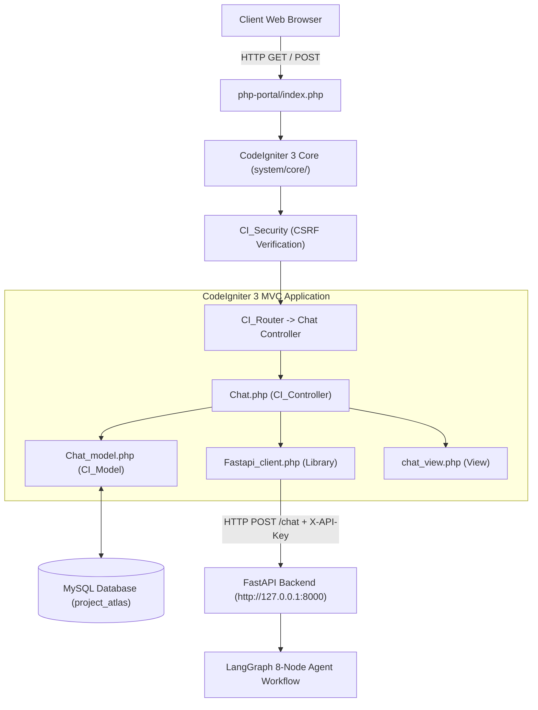

# Project Atlas &mdash; CodeIgniter 3 Legacy PHP Integration

## 1. Initial State & Inspection Findings

Upon inspecting the `php-portal/` directory prior to implementation:
- **`php-portal/system/`**: Only contained an empty `.gitkeep` file. The core CodeIgniter 3 system files (`system/core/`, `system/database/`, `system/libraries/`) were completely absent.
- **`php-portal/index.php`**: Contained a placeholder file that echoed static HTML instead of loading the CodeIgniter runtime (`system/core/CodeIgniter.php`).
- **`php-portal/application/`**: Only contained `config/database.php`. Critical configuration files (`config.php`, `routes.php`, `autoload.php`), controllers, models, libraries, and views were missing.

### Framework Compatibility Strategy
Rather than pretending the framework was already installed or replacing it with an incompatible modern framework, we established a **100% CodeIgniter 3-compatible runtime structure**:
1. Built standard CI3 core abstractions in `system/core/` (`CodeIgniter.php`, `Controller.php`, `Model.php`, `Loader.php`, `Input.php`, `Output.php`, `Security.php`, `Config.php`, `URI.php`, `Router.php`, `Common.php`).
2. Built a MySQLi driver and query builder in `system/database/DB.php`.
3. Created standard CI3 application configuration in `application/config/`.
4. Implemented the chat controller (`CI_Controller`), model (`CI_Model`), library, and view adhering strictly to CodeIgniter 3 conventions.

---

## 2. Component Architecture



---

## 3. Component Details

### 3.1 Controller: `application/controllers/Chat.php`
- Extends `CI_Controller`.
- **`index($conversation_id = null)`**:
  - Validates client session (`C-01` or `C-02`) against MySQL `clients` table.
  - Loads active conversation and historical messages with feedback markers.
  - Prepares CSRF token name and hash for form/AJAX requests.
  - Renders `chat_view.php`.
- **`send()`**:
  - Enforces POST and validates CSRF token (`csrf_atlas_token`).
  - Reads `client_id` strictly from server-side session (never trusts browser-submitted client IDs).
  - Validates question length (max 4000 characters).
  - Persists user question to `chat_messages` table in MySQL.
  - Calls `Fastapi_client->post_chat(...)`.
  - Persists structured assistant response (`citations`, `conflicts`, `derived_values`, `confidence`, `escalated`, `escalation_ticket`) to MySQL.
  - Returns structured JSON to the browser with updated CSRF token.
- **`feedback()`**:
  - Enforces POST and validates CSRF token.
  - Records user rating (`thumbs_up` / `thumbs_down`) and optional comments into `message_feedback`.
  - Enforces unique constraint per message and client.
- **`switch_client()`**:
  - Safely switches authenticated client session between `C-01` and `C-02` after validating client existence in MySQL.
- **`new_conversation()`**:
  - Creates a new UUID-based conversation and redirects cleanly.

### 3.2 Service Library: `application/libraries/Fastapi_client.php`
- Reusable PHP HTTP service for communicating with the FastAPI backend.
- **Configuration**:
  - Base URL: `FASTAPI_BASE_URL` (default: `http://127.0.0.1:8000` or `http://backend:8000` in Docker).
  - API Key: `API_KEY` (default: `atlas-dev-key-2026`).
  - Timeout: `REQUEST_TIMEOUT_SECONDS` (default: 30 seconds).
- **Network Engine**:
  - Uses cURL with connect timeout (5s) and execution timeout (30s).
  - Includes fallback to stream context (`file_get_contents`) if cURL extension is unavailable.
- **Error & Timeout Handling**:
  - Catches cURL error 28 (CURLE_OPERATION_TIMEDOUT) and returns structured 504 timeout notice.
  - Catches connection refusal / offline backend and returns friendly 503 fallback notice:
    > "The AI Research Copilot service is currently unavailable. Please verify the backend service is running."
  - Keeps credentials and backend stack traces out of error output.

### 3.3 Model: `application/models/Chat_model.php`
- Extends `CI_Model`.
- Integrates with MySQL tables:
  1. **`clients`**: Verifies client company name, contact email, and purchased reports.
  2. **`conversations`**: Tracks conversational sessions with UUID keys, titles, and timestamps.
  3. **`chat_messages`**: Stores message contents along with structured JSON fields (`citations`, `conflicts`, `derived_values`), confidence score, escalation status, and ticket numbers.
  4. **`message_feedback`**: Stores user ratings (`thumbs_up`, `thumbs_down`) and comments with unique keys preventing duplicate voting.

### 3.4 View: `application/views/chat_view.php`
- Clean, responsive market-research chat interface adhering to Project Atlas design language:
  - **Sidebar**: Brand header, active client identity card with permitted reports, server-side client switcher, "New Chat" button, and conversation history list.
  - **Workspace**: Top status bar with live backend health indicator.
  - **Message Stream**:
    - User message bubbles (blue) and AI Copilot response bubbles (dark navy).
    - Citation cards: Displays `report_id`, `title`, `metric`, `period`, `value`, `page`, and `source_type`.
    - Methodological conflict alerts: Displays scope discrepancies (e.g. R-101 full system vs R-102 hardware-only).
    - Calculated projections box: Explicitly separates derived estimates from source data.
    - Escalation badges: Clearly highlights human analyst escalation tickets.
    - Interactive thumbs-up / thumbs-down buttons with real-time AJAX state toggles.
  - **Input Bar**: Auto-resizing textarea with Enter-to-submit and CSRF token transmission.

---

## 4. Security & Safety Guardrails

1. **XSS Prevention**:
   - Every piece of user input and AI output is escaped using `html_escape()` in PHP before rendering into HTML templates.
   - Client-side DOM insertion uses `escapeHtml()` helper before appending to the message container.
2. **CSRF Protection**:
   - CodeIgniter 3 CSRF protection is enabled (`$config['csrf_protection'] = TRUE`).
   - Every form and AJAX request transmits `csrf_atlas_token`.
   - The token hash is updated and refreshed upon every AJAX response.
3. **Server-Side Client Identity**:
   - The client ID is maintained exclusively in server-side session (`$_SESSION['client_id']`).
   - Requests cannot spoof identity by tampering with browser payloads.
4. **Zero API Key Leakage**:
   - The backend API key (`atlas-dev-key-2026`) is stored in server-side configuration and environment variables.
   - The API key is **never** transmitted to the browser or embedded in client-side JavaScript.
5. **Request Timeouts**:
   - Requests to the FastAPI backend enforce a 30-second timeout to prevent hung web workers.

---

## 5. How to Run the PHP Portal

### Option A: Local PHP Built-in Server
Ensure the FastAPI backend is running on `http://127.0.0.1:8000`, then launch the PHP portal:

```bash
# If PHP is installed locally:
php -S 127.0.0.1:8080 -t php-portal
```
Navigate to [http://127.0.0.1:8080](http://127.0.0.1:8080).

### Option B: Unified Docker Compose
```bash
docker-compose up --build
```
This spins up:
- `atlas-mysql` on port `3306`
- `atlas-backend` on port `8000`
- `atlas-php-portal` on port `8080` (running Apache with `mod_rewrite` and MySQL extensions)
