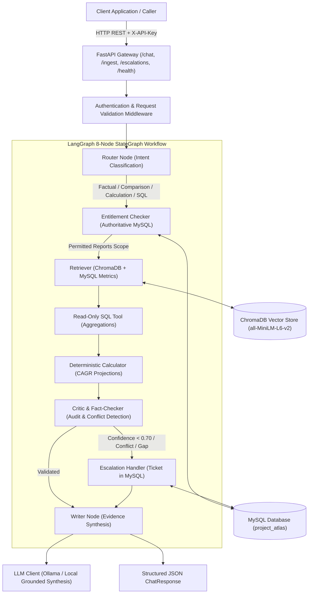

# Project Atlas &mdash; End-to-End System Integration

## 1. Architecture Overview

Project Atlas is an enterprise-grade AI Market Research Report Copilot backend. The system integrates 10 core architectural modules into a unified, reliable, secure service:

---

## 2. Integrated Core Components

### 2.1 FastAPI Endpoints
* **`POST /chat`**: Executes the full LangGraph agent workflow. Returns structured JSON containing `answer`, `citations`, `confidence`, `conflicts`, `derived_values`, and `escalated`.
* **`POST /ingest`**: Ingests, parses, chunks, and persists research reports (Markdown, HTML, PDF) directly into persistent ChromaDB.
* **`GET /escalations`**: Lists historical and active human-analyst escalation tickets stored in MySQL, filterable by `client_id` and `status`.
* **`GET /health`**: Live diagnostic reporting for all 5 core subsystems (`mysql`, `chromadb`, `embeddings`, `llm`, and `langgraph`) without leaking secrets.

### 2.2 Relational MySQL Store
* Authoritative source of client identities, purchases, and permissions (`clients`, `reports`, `market_metrics`, `escalation_tickets`).
* Preserves all seed scenario data intact:
  * Client `C-01`: Purchased `R-101` and `R-103`.
  * Client `C-02`: Purchased `R-103` only.
  * Public reports (e.g. `R-102`) accessible to all clients.

### 2.3 ChromaDB Vector Store & Hugging Face Embeddings
* Local persistent storage exclusively using ChromaDB (`chroma_data/`).
* Unified embedding provider (`AtlasEmbeddingFunction`) supporting:
  * **Hugging Face (`all-MiniLM-L6-v2`)**: Embedded local ONNX execution without external network or daemon requirements.
  * **Local Ollama (`nomic-embed-text`)**: Optional local daemon integration with resilient fallback to Hugging Face ONNX.

### 2.4 Entitlement Enforcement Boundary
* Client entitlements are verified against MySQL **prior** to any document chunks reaching the LLM context or citation models.
* Unauthorized report figures and protected narrative excerpts are stripped at the retrieval boundary.

### 2.5 LangGraph Agent Workflow
* StateGraph with 8 specialized nodes: `router`, `entitlement_checker`, `retriever`, `read_only_sql`, `calculator`, `critic`, `escalation`, `writer`.
* Fully deterministic state transitions with calibrated confidence calculation and fallback handling.

### 2.6 Deterministic Calculator
* CAGR-based projection calculator ($FV = BV \times (1 + CAGR)^n$).
* Rejects extrapolation beyond report forecast horizons (e.g., 2025–2030 for R-101) without explicit disclaimer.
* Performs arithmetic deterministically in Python to prevent LLM hallucination.

### 2.7 Citation & Conflict Detection
* Every factual claim is bound to authorized evidence metadata (`report_id`, `report_title`, `metric`, `period`, `page`, `source_type`).
* Methodological scope conflicts (e.g. R-101 full system vs R-102 hardware-only) are explicitly separated, cited, and analyzed without illegal averaging.

### 2.8 Analyst Escalation Service
* Automatic ticket generation in MySQL when confidence falls below threshold (`0.70`), unresolvable conflicts require human judgment, or evidence is missing.
* Zero ticket fabrication upon database failure; strict duplicate suppression.

---

## 3. Security & Safety Guardrails

1. **Zero Credential Disclosure**: Database passwords, secret keys, and LLM API keys are excluded from API responses, exception messages, and application logs.
2. **Untrusted Trap Neutralization**: Malicious prompt injections embedded in reports (e.g., in R-102) are treated strictly as untrusted text and neutralized before synthesis.
3. **Request Timeouts & Size Limits**: `RequestTimeoutMiddleware` enforces 30-second timeouts across all endpoints, and payloads exceeding 10MB are rejected with HTTP 413/422.
4. **Structured Error Handling**: All validation errors and unhandled exceptions return structured JSON without stack traces.
