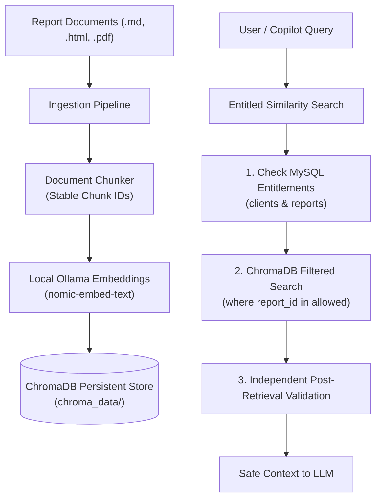

# Project Atlas &mdash; Vector Database Integration Guide

**Database**: ChromaDB (Exclusive &mdash; No Pinecone)  
**Embedding Engine**: Local Ollama (`nomic-embed-text`) with embedded local onnx fallback  
**Persistence Location**: Configurable via `CHROMA_PERSIST_DIRECTORY` (Default: `chroma_data/`)  

---

## 1. Overview & Architecture

Project Atlas utilizes **ChromaDB exclusively** for persistent local vector storage of unstructured and semi-structured market research documents. Pinecone is not installed, configured, or used.

The vector database integration provides:
1. **Local Persistent Storage**: All vector embeddings, document chunks, and metadata are persisted locally on disk using ChromaDB's `PersistentClient`. Data survives process and container restarts.
2. **Local Ollama Embeddings**: Vector embeddings are computed locally using Ollama (`nomic-embed-text`), with automatic resilient fallback to local ONNX embeddings during testing or when the Ollama daemon is offline.
3. **Deterministic Stable Chunk IDs**: Chunk IDs follow the format `{report_id}_p{page}_c{chunk}_{hash[:8]}`, ensuring idempotent upserts and preventing duplicate records during repeated ingestion cycles.
4. **Defense-in-Depth Entitlement Security**: Vector search results are independently validated against MySQL client purchase entitlements before text is surfaced or passed to the LLM.



---

## 2. Metadata Schema

Every vector chunk stored in ChromaDB contains the following normalized metadata fields:

| Field | Type | Description | Example |
| :--- | :--- | :--- | :--- |
| `report_id` | `string` | Target market research report identifier | `"R-101"` |
| `sector` | `string` | Industry vertical / market sector | `"Utilities"` |
| `region` | `string` | Geographic focus | `"Global"`, `"APAC"`, `"Europe"` |
| `year` | `string` | Publication or target evaluation year | `"2025"` |
| `page` | `integer` | Source document page number | `1` |
| `title` | `string` | Title of the parent report | `"Global Smart Water Meter Market 2025"` |
| `is_synthetic` | `boolean` | Flag marking synthetic benchmark documents | `false` |

---

## 3. Security Boundary: Independent Entitlement Verification

> [!IMPORTANT]
> **ChromaDB metadata filtering is NOT the sole security boundary.**
> 
> Even if a vector search query produces matching chunks, the application enforces an independent verification layer via [`VectorStoreService.entitled_similarity_search`](file:///c:/Users/NEW%20BAG%20COLLECTION/OneDrive/Desktop/Assets/Project-Atlass/backend/app/retrieval/vector_store.py):
> 
> 1. **MySQL Entitlement Lookup**: Queries the `clients` table in MySQL to retrieve the client's purchased report IDs, and queries the `reports` table for public reports (`access = 'public'`).
> 2. **ChromaDB Pre-Filtering**: Applies a `where={"report_id": {"$in": allowed_reports}}` constraint.
> 3. **Independent Post-Retrieval Audit**: Iterates over each candidate chunk and explicitly checks `ClientService.check_report_access(db, client_id, chunk_report_id)`.
> 4. **Strict Rejection**: Any chunk associated with an unpurchased paid report is dropped and logged as a security alert before reaching the LLM or chat response.

---

## 4. How to Initialize Collection & Ingest Reports

### Option A: Using the CLI Script
To discover documents in `documents/sample_reports/`, parse them, compute Ollama embeddings, and upsert chunks into ChromaDB:

```bash
python scripts/ingest_reports.py
```

### Option B: Using the FastAPI Ingestion API
Authenticated API callers can ingest text or documents dynamically:

```bash
curl -X POST http://127.0.0.1:8000/ingest \
  -H "Content-Type: application/json" \
  -H "X-API-Key: atlas-dev-key-2026" \
  -d '{
    "report_id": "R-101",
    "title": "Global Smart Water Meter Market 2025",
    "file_path": "sample_reports/R-101.md",
    "metadata": {
      "sector": "Utilities",
      "region": "Global",
      "year": "2025"
    }
  }'
```

### Option C: Python Service Interface
```python
from pathlib import Path
from app.ingestion.pipeline import ReportIngestionPipeline
from app.retrieval.vector_store import vector_store_service

# Initialize pipeline and ingest
pipeline = ReportIngestionPipeline(chunk_size=400, chunk_overlap=40)
summary = pipeline.execute_pipeline(Path("documents/sample_reports"), load_to_chroma=True)

# Query with metadata filtering
results = vector_store_service.similarity_search(
    query="smart water meters CAGR",
    n_results=3,
    where={"sector": "Utilities"}
)
```

---

## 5. Verification & Testing

Run the full vector store test suite:
```bash
pytest backend/tests/test_vector_store.py -v
```

The test suite validates:
* Chunk insertion and collection counting.
* Semantic similarity search and cosine distance ranking.
* Preservation of all 5 mandatory metadata fields (`report_id`, `sector`, `region`, `year`, `page`).
* Metadata filtering via `where={"sector": ...}`.
* Idempotency and deduplication upon repeated chunk ingestion.
* Data persistence across client re-instantiations and process restarts.
* MySQL client purchase entitlement enforcement (verifying client `C-02` cannot retrieve `R-101` chunks).
